# STT Platform

**A provider-neutral speech-to-text platform.** One headless `/v1` API turns
audio into timestamped transcripts through swappable providers — a local
Faster-Whisper `large-v3-turbo` on CUDA, or a managed API — behind a single
internal contract. A separate React + TypeScript app consumes only that API,
so voice agents, scripts and the UI are all just clients.

Built phase by phase under strict TDD: **8 phases (0–7), all complete.**
Verified locally with **420 backend tests + 3 GPU tests + 48 frontend tests**,
plus real-stack end-to-end drivers that use the actual GPU, the actual
Temporal server and the actual object store.

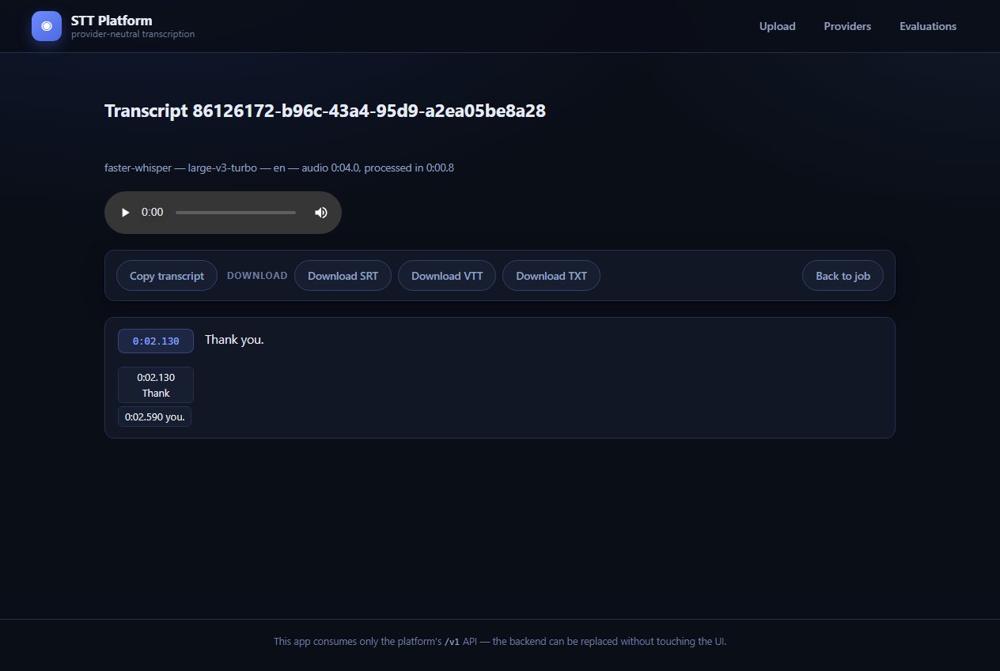

---

## Why it is shaped this way

* **Provider neutrality is the product.** Providers are interchangeable
  behind one contract (`transcribe` or `submit → poll → fetch`); capability
  differences are *discovered*, never assumed, and each capability is marked
  `documented` until our own live run proves it, then `verified`.
* **Durability is the default.** Job state lives in PostgreSQL, dispatch
  goes through a transactional outbox, execution runs as Temporal workflows
  with retries implemented *in the workflow* so every attempt writes a
  visible `RETRY_WAIT` transition. A killed worker does not lose a job.
* **Honesty is enforced.** A metric that could not be measured is `None`,
  never `0.0`. A job that failed says why and whether retrying is honest.
  Unverified reference audio is never scored.
* **Privacy is structural.** Audio is stored under opaque tenant-scoped keys,
  local-only audio is never silently routed to a cloud provider, and
  transcripts, audio bytes and secrets never reach the logs.

## Architecture

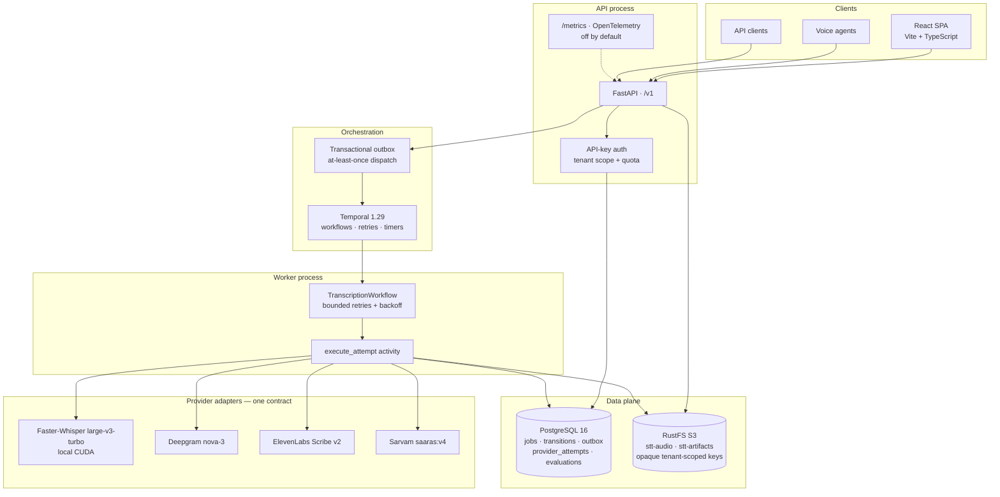

Ports on a local run: API `8200` · Postgres `25432` · RustFS `29000` ·
Temporal `7233` (UI `28080`) · frontend dev server `5173` · MLflow `5000`.

## The life of a request

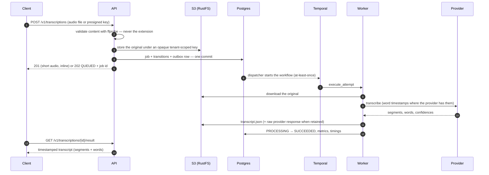

Short audio is transcribed inside the request; anything longer answers `202`
and is processed by the worker — the client polls the same URL either way.

## Job lifecycle

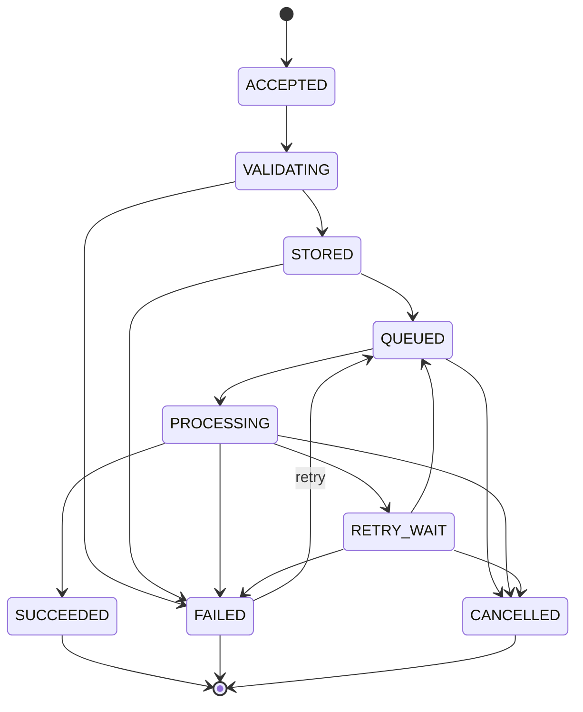

Every transition is a row, so the trail *is* the audit log. A real one, from
the Phase 7 chaos test — the worker was killed mid-transcription:

```
VALIDATING -> STORED -> QUEUED -> PROCESSING -> RETRY_WAIT -> QUEUED -> PROCESSING -> SUCCEEDED
```

## The UI

| | |
|---|---|
| 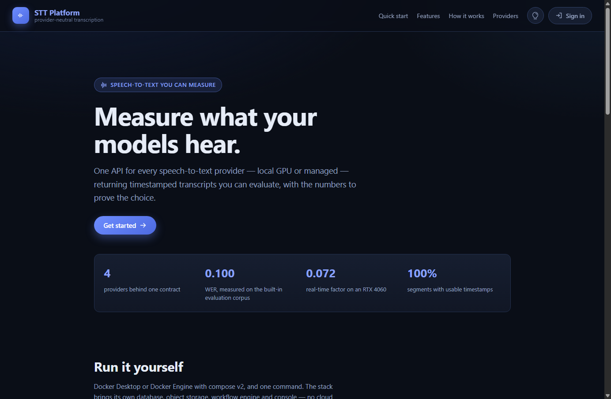 | 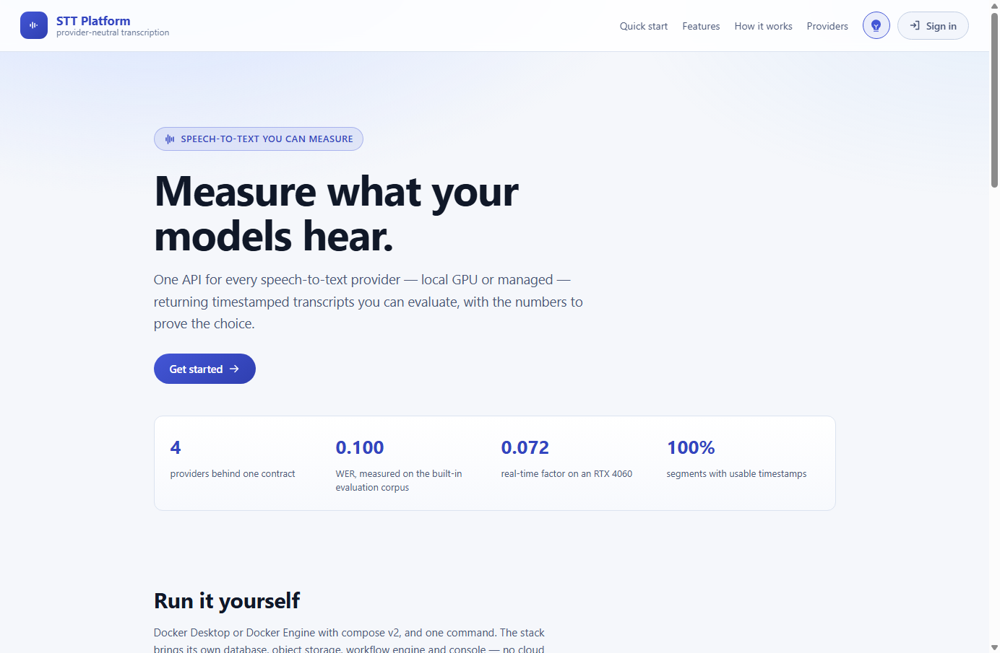 |
| The public landing page — what it does, how a job runs, how to run it | The same page in light mode |
| 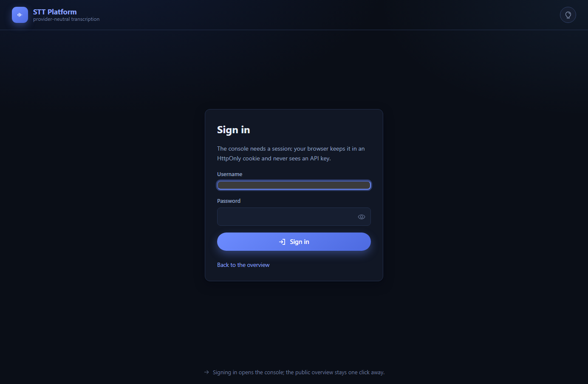 | 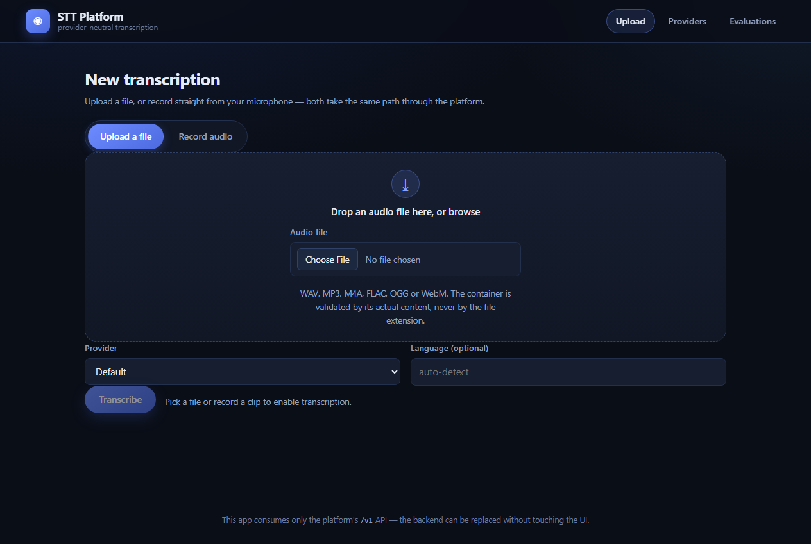 |
| Sign in: the browser holds a session cookie, never a key | Upload a file, or record in the browser |
| 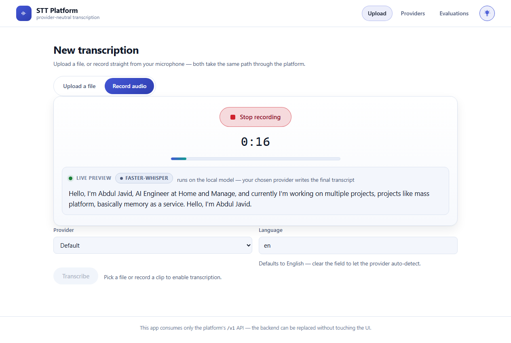 |  |
| Live transcription while the microphone is open | Transcript: time gutter, segments, word chips |
| 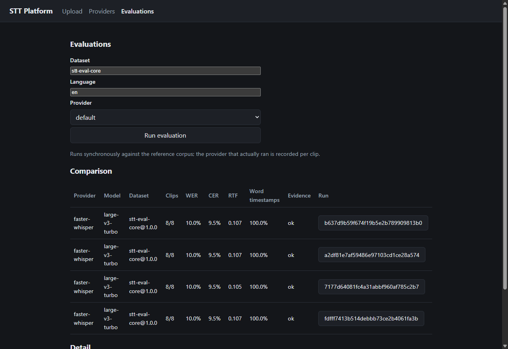 | 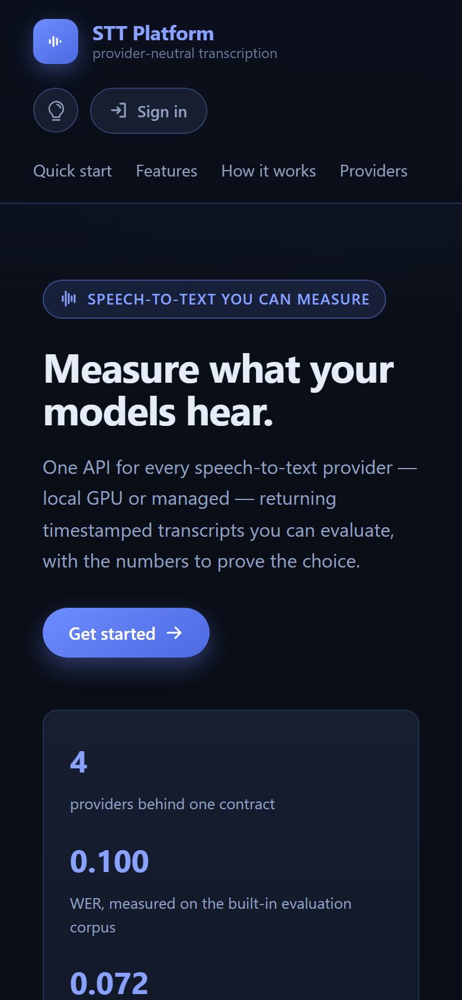 |
| Evaluations: summary cards, search, sortable columns, detail card | The landing page at 390 px |

`/` and `/login` are public; the console sits behind a route guard that asks
`GET /v1/auth/me` once and renders nothing until it knows the answer. The
session is an `HttpOnly`, `SameSite=Lax` cookie and the **server** assigns the
tenant — nothing the browser sends can change the scope, and no token is ever
written to `localStorage`. API keys keep working alongside cookies.

### Signing in

| Where | Username | Password |
|---|---|---|
| Development (`uv run`, source checkout) | `stt` | `stt` |
| Docker (`./launch.sh`) | `stt` | generated into `.env` on first run and printed once |

The development default is a **server-side** default (`STT_UI_USERNAME` /
`STT_UI_PASSWORD` in `backend/src/stt_platform/core/config.py`) — the frontend
bundle contains no credentials, and the login page only shows the `stt` / `stt`
hint when the server reports that development defaults are actually in use
(`GET /v1/auth/config` → `dev_credentials`). Point `./launch.sh` at a real
deployment and that hint disappears on its own.

**Changing the credentials.**

```bash
# Docker: edit the generated .env, then recreate the API and the worker
STT_UI_USERNAME=stt
STT_UI_PASSWORD=choose-something-long        # or, better, a hash:
STT_UI_PASSWORD_HASH=$2b$12$...              # see below
STT_SESSION_SECRET=<64 hex chars>            # rotating it invalidates sessions
./launch.sh restart

# Local development: same variables, exported or in backend/.env
export STT_UI_PASSWORD='...'
```

Prefer a hash: `STT_UI_PASSWORD_HASH` takes the platform's own self-describing
scrypt hash (`scrypt$n$r$p$salt$hash`), so the plaintext never sits in the
environment or in `docker inspect` output. Generate one with

```bash
cd backend && uv run python -c "from stt_platform.services.auth import hash_password; print(hash_password('your-password'))"
```

and remove `STT_UI_PASSWORD` when you set it (a hash wins over the plaintext
field).

**Production refuses weak credentials.** With `STT_ENVIRONMENT=production` the
app will not start when UI auth is on and:

- neither `STT_UI_PASSWORD_HASH` nor `STT_UI_PASSWORD` is set,
- the password is shorter than 12 characters and no hash is given, or
- `STT_SESSION_SECRET` is missing — without it every restart invalidates every
  session and a multi-replica deployment cannot verify its own tokens.

It also forces `Secure` session cookies unless `session_cookie_secure` is
explicitly set to false (a TLS-terminating proxy may need that opt-out). Every
one of these is a startup failure with a message naming the variable, not a
warning in a log.

Every icon is a Phosphor icon; a test enforces it (no emoji standing in for an
icon), and another enforces that no stylesheet token references itself.

The transcript page (top of this README) renders segments with word-level
timestamps, copies the plain text in one click, and exports TXT/SRT/VTT.

**Live transcription while you speak.** While the microphone is open the page
sends the audio captured so far to `POST /v1/transcriptions/preview` every few
seconds and shows the text as it grows. The preview is deliberately modest: it
runs on the **local** model only (a managed API would be dialled every few
seconds, spending quota nobody asked to spend), it creates no job, stores no
audio, and returns `is_final: false` so it can never be mistaken for the
transcript your chosen provider writes afterwards.

**Recording in the browser.** The upload page has a *Record audio* tab: the
browser captures the microphone with `MediaRecorder`, shows a live timer and
input level, lets you preview and discard the take, and hands the finished clip
to the exact same upload path as a chosen file — one provider contract, no
special case. The microphone is released on stop, on discard, and on leaving
the page. Browser recordings are streaming WebM with **no duration header**;
the platform measures the real duration by decoding the stream instead of
rejecting the file (see `docs/ui.md`).

**Light and dark.** The header carries a bulb: the app follows your operating
system until you choose, remembers the choice, applies it before the first
paint (no flash), and hands `color-scheme` to the browser so native controls —
the audio player, selects, the file picker — match. The favicon, the app icon
and the manifest ship with it.

## Providers

| Provider | Kind | Models used | Word timestamps | Diarization | Status |
|---|---|---|---|---|---|
| Faster-Whisper (local) | CUDA, in-process | `large-v3-turbo` | yes | no | **verified** |
| Deepgram | managed, sync | `nova-3` | yes | yes | **verified** (1 live run) |
| ElevenLabs Scribe | managed, sync | `scribe_v2` | yes | yes | **verified** (1 live run) |
| Sarvam AI | managed, batch | `saaras:v4` | no (segment-level) | yes | **verified** (1 live run) |
| Amazon Transcribe | managed | — | — | — | deferred (no verified AWS setup) |

Managed providers register only when their API key is configured, so a missing
key means "not offered", never a 500. Live verification used free-tier keys,
STT models only, one 10 s clip each — see `docs/live-provider-verification.md`.

## Quickstart

**Everything, in one command** — Docker Desktop (or Docker Engine with compose
v2) and nothing else. No Python, no Node, no Postgres on the host:

```bash
chmod +x launch.sh
./launch.sh                 # add "gpu" to run the local model on CUDA
```

That builds the API, worker and console images, starts Postgres, S3-compatible
storage, Temporal and the console, migrates the schema, generates the UI
credentials into a gitignored `.env`, and waits until the platform answers.

| | |
|---|---|
| console | <http://127.0.0.1:8080> |
| API + docs | <http://127.0.0.1:8200/v1> · <http://127.0.0.1:8200/docs> |
| workflows | <http://127.0.0.1:28080> |

`./launch.sh status` shows what is healthy, `./launch.sh logs api` follows the
API, `./launch.sh stop` keeps your data. The full guide — ports, environment
variables, GPU passthrough, backup, troubleshooting — is in
[`docs/deployment.md`](docs/deployment.md).

### From source (development)

Prerequisites: `uv`, FFmpeg/ffprobe, Docker Desktop, Node 22+, and an NVIDIA
GPU with CUDA if you want the local provider on GPU.

```bash
# 1. infrastructure only: Postgres, RustFS (S3), Temporal, Temporal UI
cd infrastructure && docker compose up -d --wait

# 2. backend: schema, then API + worker in two shells
cd ../backend
uv sync
uv run alembic upgrade head
uv run uvicorn stt_platform.main:app --host 127.0.0.1 --port 8200
uv run python -m stt_platform.workers.transcription_worker

# 3. transcribe something
curl -s -F "file=@audio/sample.wav" http://127.0.0.1:8200/v1/transcriptions

# 4. frontend
cd ../frontend && npm install && npm run dev     # http://127.0.0.1:5173
```

Configuration lives in `backend/.env` (gitignored; `.env.example` documents
every variable and carries no values).

## API

All routes are under `/v1`. With `STT_AUTH_ENABLED=true`, everything except
the health probes requires an `X-API-Key` header.

| Method | Route | Purpose |
|---|---|---|
| `POST` | `/transcriptions` | submit audio (multipart) or a presigned object key |
| `GET` | `/transcriptions/{id}` | job state, provider, model, attempts, failure |
| `GET` | `/transcriptions/{id}/result` | the timestamped transcript |
| `POST` | `/transcriptions/{id}/retry` | retry a failed job (honest about retryability) |
| `POST` | `/transcriptions/{id}/cancel` | cancel a queued or running job |
| `DELETE` | `/transcriptions/{id}` | delete job + objects + rows (tenant-scoped) |
| `POST` | `/transcriptions/uploads/presign` | presigned upload for large files |
| `POST` | `/transcriptions/preview` | live preview while recording — transient, local provider only |
| `GET` | `/providers` | capability matrix with provenance per capability |
| `POST` | `/evaluations` | run an evaluation against a reference dataset |
| `GET` | `/evaluations`, `/evaluations/{id}` | run history and comparison |
| `GET` | `/health/live`, `/health/ready` | probes (never authenticated) |

## Security and privacy

* **Tenant scope is server-assigned.** The tenant comes from the presented
  key, never from a request field; keys are compared in constant time; with
  auth on and no keys configured the API fails *closed*.
* **Authorization on read and write.** Another tenant's job is a `404`, not a
  `403` — existence is not confirmed.
* **Quotas** per tenant per minute at the API edge (in-process limiter — the
  documented single-node trade-off).
* **Retention and deletion.** `DELETE` removes audio, artifacts, the local
  copy and every row; `scripts/purge_expired.py` applies a retention window
  to terminal jobs only, with a non-destructive `--dry-run`.
* **Buckets are private** — asserted against the real RustFS: anonymous reads
  refused, no public ACL grants, no wildcard principals.
* **No secrets in git or the frontend** — enforced by tests, not habit.
* **Logs are redacted** — secrets, audio bytes and transcript text never
  appear; verified by tests on the real request path.

## Evaluation

`docs/evaluation.md` in full. Short version: a versioned reference dataset
with honest provenance, WER/CER cross-checked against `jiwer`, timestamp
quality metrics, and the operational picture (queue wait, RTF, retries) taken
from the real job records. Synthetic clips (ground truth by construction) are
scored; unverified human audio is never scored. Runs log to MLflow
best-effort — a dead tracking server yields `mlflow: {status: error}` and
never fails an evaluation.

Measured baseline (`large-v3-turbo`, 8 clips): **WER 0.100** micro / 0.118
macro, **CER 0.095**, **RTF 0.072**, word timestamps on 100% of clips.

## Operations

`docs/operations.md` (services, ports, config, routine tasks, backups,
capacity) and `docs/incident-recovery.md` (runbooks: power cut, Postgres
down, storage down, Temporal down, provider outage, stuck jobs, disk full,
credential exposure, deletion requests).

Measured capacity on one RTX 4060 with 10 s clips (`scripts/load_test.py`):

| Load | Wall | Throughput | p50 | p95 | Errors |
|---|---|---|---|---|---|
| 12 requests, concurrency 4 | 8.5 s | 1.41 req/s | 2.63 s | 2.66 s | 0 |
| 24 requests, concurrency 8 | 16.5 s | 1.45 req/s | 5.25 s | 5.45 s | 0 |

Throughput saturates near 1.45 req/s because one GPU serializes inference —
extra concurrency buys queue depth, not speed. Raise it with more GPUs or by
routing eligible tenants to a managed provider.

## Testing

```bash
cd backend
uv run pytest -q                     # 469 passed, 3 skipped, 7 deselected (live-provider)
uv run pytest -m gpu -q              # 3 passed — real GPU evaluation
uv run ruff check src tests ../scripts

cd ../frontend
npm test                             # 156 passed
npm run build
```

Real-stack drivers (they start processes, use the GPU and the compose stack):

```bash
python scripts/e2e_phase2.py         # durable async pipeline
python scripts/e2e_phase3_frontend.py# browser e2e for the UI
python scripts/e2e_phase4.py         # managed providers against a fake vendor
python scripts/e2e_phase5.py         # observability across two processes
python scripts/e2e_phase6.py         # evaluation against real MLflow
python scripts/e2e_phase7.py         # auth, tenancy, quota, chaos recovery, deletion
python scripts/load_test.py          # latency/throughput under concurrency
```

Tests that need the stack **skip** rather than fail when it is absent — check
for skips before reading a green run as proof.

## Repository layout

| Path | Purpose |
|---|---|
| `backend/` | FastAPI service + Temporal worker (uv, Python 3.13) |
| `frontend/` | React + TypeScript + Vite app (consumes only `/v1`) |
| `infrastructure/` | Docker Compose: PostgreSQL, RustFS, Temporal, Temporal UI |
| `scripts/` | e2e drivers, load harness, purge tool, corpus generator |
| `docs/` | architecture, per-phase reports, operations, incident recovery |
| `models/`, `.cache/`, `audio/`, `results/` | local artifacts — never committed |
| `app.py`, `benchmark_*.py` | pre-existing prototype scripts, preserved (ADR-006) |

No audio files are committed (ADR-007): test fixtures are synthesized at test
time, and the evaluation corpus is regenerated with
`scripts/make_eval_corpus.py`.

## Documentation

| Document | Contents |
|---|---|
| `docs/architecture.md` | architecture, ADR log, ports |
| `docs/api.md` | `/v1` walkthrough with verified example runs |
| `docs/reliability.md` | guarantees (outbox, retries, cancellation), known gaps |
| `docs/providers.md` | capability matrix, config, fidelity rules |
| `docs/live-provider-verification.md` | live vendor runs: numbers, defects, evidence |
| `docs/observability.md` | traces, logs, metric catalog, dashboard, alerts |
| `docs/evaluation.md` | datasets, metrics, normalization, MLflow, limits |
| `docs/ui.md` | frontend: pages, the browser recorder, streaming-WebM duration, design rules |
| `docs/deployment.md` | the one-command Docker stack: ports, env vars, GPU, backup, troubleshooting |
| `docs/operations.md` | running it: config, routine tasks, backups, capacity |
| `docs/incident-recovery.md` | what breaks, what the platform does, what you do |
| `docs/phase-{0..7}-report.md` | per-phase evidence and limitations |
| `docs/superpowers/plans/` | the plan each phase was built from |

## License

No license file yet — the author has not chosen one, so all rights are
reserved by default. Open an issue if you need a specific license.
